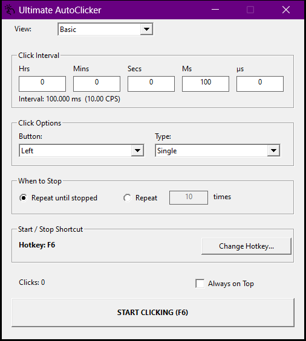
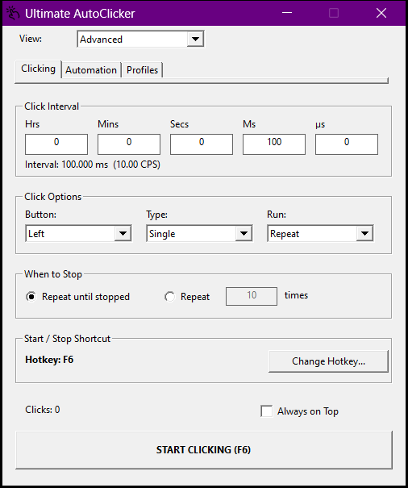
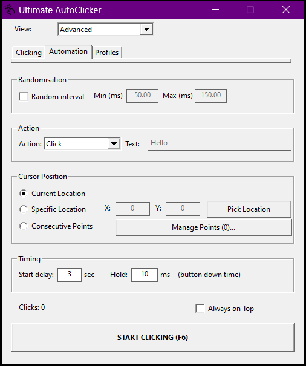
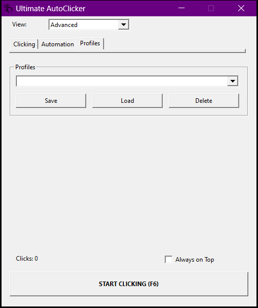

<div align="center">
  <h1>Ultimate AutoClicker</h1>
  <p>
    <b>A lightweight native auto-clicker for Windows and Linux X11.</b>
  </p>
</div>

Ultimate AutoClicker is a high-precision, zero-drift mouse automation utility engineered for demanding tasks, game automation, and testing workflows.

The Windows edition uses native Win32 APIs, high-resolution timers, QueryPerformanceCounter scheduling, and Per-Monitor V2 DPI awareness. The Linux edition uses GTK 3, X11 XTEST input, and a monotonic, interruptible clock with the same tested automation engine. Performance depends on the desktop and target application.

<hr>

## Quick Start & Building

### Download for Windows
Download **[UltimateAutoClicker.exe](https://github.com/kuy124/UltimateAutoClicker/releases/latest/download/UltimateAutoClicker.exe)** and run it. No installation is required.

The app runs without administrator permissions. To automate an app running as administrator, launch AutoClicker using **Run as administrator** too; Windows blocks normal apps from sending input to elevated apps.

### What's new in 1.2.3
* **Screen-edge emergency stop:** move the cursor to any monitor edge to stop automation, cancel countdowns, and release held buttons.
* **Clear safety feedback:** a pulsing red border, click-through warning, and persistent stop status; restart manually when ready.
* **Safer double clicks:** stopping during a click prevents the second press; programmed cursor moves do not trigger the emergency stop.

### What's new in 1.2.2
* **Two platform editions:** Windows and Linux X11; Linux downloads include DEB, RPM, tar.gz, tar.xz, and ZIP packages, with SHA-256 checksums.
* **Basic by default:** essential click controls with more space between settings.
* **Focused Advanced tabs:** Clicking, Automation, and Profiles replace the crowded all-in-one panel.
* **Clearer controls:** interval labels above inputs, improved grouping, and a larger Start/Stop button visible on every tab.
* **Simpler footer:** click count only; elapsed time, CPS, and the advanced-settings note have been removed.

### Download and build for Linux (X11)

Get Linux packages from [release 1.2.3](https://github.com/kuy124/UltimateAutoClicker/releases/tag/1.2.3).
These packages target **x86-64 Linux**, built on Ubuntu 24.04 (glibc 2.39); build from source on older distributions.
Choose `.deb` for Debian/Ubuntu, `.rpm` for RPM-based distributions, or `.tar.gz`, `.tar.xz`, or `.zip` for manual installation.
Archives require GTK 3, libX11, and libXtst installed separately. Verify downloads with the accompanying `SHA256SUMS-linux.txt`.

```sh
sudo apt install ./UltimateAutoClicker-1.2.3-Linux-x86_64.deb
# Or extract an archive and run ./bin/ultimate-autoclicker
```

Use an **X11/Xorg session**. Native Wayland automation is unsupported; XWayland cannot control native Wayland applications.
No root or input-device permissions are needed to run the app. **F6** toggles automation globally.
The Linux interface supports interval/randomization, all three mouse buttons, single/double/hold clicks, scrolling, fixed coordinates, repeat limits, countdown, and hold duration.
Windows-only interface features (profiles, sequence editing/recording, typing, custom hotkey capture, and Basic/Advanced tabs) are not exposed in the Linux edition.
Settings live in `$XDG_CONFIG_HOME/ultimate-autoclicker/settings.ini` (default `~/.config/ultimate-autoclicker/settings.ini`).

```sh
sudo apt install build-essential cmake pkg-config libgtk-3-dev libxtst-dev
sh build.sh
./build/linux/ultimate-autoclicker
# Testing and packaging additionally require:
sudo apt install xvfb xauth rpm zip unzip cpio
sh test.sh
sh package.sh
```

`package.sh` runs the shared engine tests and real GTK/XTEST integration checks under Xvfb, then creates five package formats and checksums in `build/linux/`.
RPM-based source builds need the equivalent GTK 3, X11, Xtst development packages, CMake, GCC, pkg-config, Xvfb, xauth, rpm-build, and zip.

### Option A: Windows 1-Click Build Script (`build.bat`)
If you have MinGW-w64 / GCC installed:
1. Double-click `build.bat` in the project directory.
2. The script compiles `assets/resource.rc` and builds `bin/UltimateAutoClicker.exe`.

### Option B: Manual Command Line Compilation
From your terminal inside the project directory:
```bash
mkdir build
mkdir bin
windres -I assets assets/resource.rc -O coff -o build/resource.res
g++ src/core.cpp src/main.cpp build/resource.res -o bin/UltimateAutoClicker.exe -mwindows -lcomctl32 -lshell32 -static -s -Os -fno-exceptions -fno-rtti -DUNICODE -D_UNICODE
```

> `-DUNICODE -D_UNICODE` matters: without it `DefWindowProc` resolves to the ANSI variant and mangles wide strings.

<hr>

## Core Features & Capabilities

### Basic and Advanced interfaces

The interface starts in **Basic** on every launch, with spaced-out interval, mouse button, click type, repeat count, and start/stop shortcut controls. Use the **View** selector for **Advanced**, organised into **Clicking**, **Automation**, and **Profiles** tabs instead of one long settings panel. Start/Stop stays visible on every tab. Switching views preserves settings, including active settings on hidden tabs. The mode selection is not saved.

### Screenshots

#### Basic
Essential click controls, with Basic selected on every launch.



#### Advanced — Clicking
Click settings and random intervals, without the automation controls crowding the screen.



#### Advanced — Automation
Alternate actions, cursor locations, point sequences, and timing controls.



#### Advanced — Profiles
Save and restore named configurations.



### Project layout

```text
src/       C++ application and engine
assets/    Icon, manifest, and Windows resource file
screenshots/ App screenshots used in this README
tests/     Engine test source
build/     Generated test executables and compiled resources (ignored)
bin/       Application executable and portable settings (ignored)
```

Run `build.bat` or `test.bat` from the project root. Launch the app from `bin/UltimateAutoClicker.exe`.

### 1. Zero-Drift QPC Engine (1,000+ CPS)
* **Master Grid Scheduling:** Employs `QueryPerformanceCounter` (QPC) absolute time grid tracking. Successive clicks are anchored to hardware timestamp deadlines, eliminating cumulative delay drift entirely.
* **Single-Core Thread Affinity:** The time-critical worker thread is pinned to the primary processor core, preventing cross-core cache invalidation and QPC timing jitter.
* **Adaptive Syscall Batching:** For sub-millisecond rates, mouse down and up events are batched into a single atomic `SendInput` driver packet, avoiding Windows input queue congestion.

### 2. Start Countdown (click where it matters)
* Press **Start / Stop** and the engine waits the configured **Start delay** (3 seconds by default) before the first click, so you can move the pointer onto the target first.
* The main button counts down (`CANCEL - STARTING IN 3 s`) and pressing it again cancels the countdown.

### 3. Randomised Intervals
* Tick **Random interval** and set a minimum and maximum in milliseconds.
* Every gap is drawn at random inside that range, which keeps the rhythm from looking mechanical.

### 4. Consecutive Multi-Point Click Queue & Record/Replay
* **Dynamic Point Sequence:** Set multiple target coordinates. The engine cycles through each position in sequence.
* **Interactive Screen Picker:** Click **Pick Location** to record exact coordinates directly with your mouse.
* **Per-Point Delays:** Give every point its own delay, or capture a real click sequence with **Record clicks** and replay it with the original timing.
* **Atomic Sub-Pixel Coordinates:** `MOUSEEVENTF_ABSOLUTE | MOUSEEVENTF_VIRTUALDESK` is embedded in the click packets, so clicks land on target coordinates even during high-speed multi-monitor cursor jumps.

### 5. Full High-DPI Scaling Support (Per-Monitor V2)
* Coordinates remain accurate on displays scaled at **125%**, **150%**, **175%**, or **200%+**.
* The main window keeps a compact 500-pixel content width, with 530-pixel Basic and 570-pixel Advanced content heights, including on scaled displays. Dialog controls and fonts scale with display DPI, and their sizes account for title bars and borders. The main window scrolls on shorter screens.

### 6. Smart Interval Auto-Conversion
* Enter decimals or large numbers across **Hours**, **Minutes**, **Seconds**, **Milliseconds**, and **Microseconds ($\mu\text{s}$)** fields.
* Pressing **Enter** inside any box immediately normalizes and distributes values across all unit fields.

### 7. True Multi-Key Global Hotkeys
* A low level keyboard hook (`WH_KEYBOARD_LL`) matches the exact set of held keys, so `F6`, `Ctrl + Shift + Q` and combinations like `X + Z` all work while another application has the focus.

### 8. More Actions Than Clicks
* **Action:** Click, Scroll Up, Scroll Down, or Type Text (types the text box one character per interval).
* **Mode:** Repeat until stopped, Repeat *N* times, or a single click.
* **Type:** Single, Double, or Hold (press and hold the button down until stopped).
* **Hold:** Configurable time the mouse button stays down.

### 9. System Tray, Statistics & Profiles
* Minimise the window to the system tray, or keep it floating with **Always on Top**.
* Live **click count** while it runs, without extra statistics crowding the interface.
* Save the current settings as a named **profile** and load it again later.

<hr>

### 10. Screen-edge Emergency Stop
* Move the cursor into the outer **5 pixels of any monitor** to stop automation immediately, including countdowns and held buttons. Restart manually with **Start** or your hotkey.
* A pulsing red screen border and click-through warning confirm the stop without stealing focus. The app keeps the stop reason visible, and reduced-motion settings disable animation.
* Programmed cursor moves do not trigger the stop. Linux X11 uses cursor-position polling; desktops without a compositor show a compact warning instead of the full-screen border.

## How to Use

1. **Set Interval:** Specify your interval across the time boxes and press **Enter** to commit. Use **$\mu\text{s}$** for sub-millisecond intervals.
2. **Set Start Delay (optional):** Switch to **Advanced → Automation** to change the delay before clicking (3 seconds by default).
3. **Select Mouse Button & Type:** Choose Left, Right, or Middle button, and Single, Double or Hold.
4. **Set Repeat Limit:** Choose **Repeat until stopped** or set a fixed click count.
5. **Choose Location Mode (optional):** Open **Advanced → Automation** for:
   * **Current Location:** Clicks wherever your pointer is positioned.
   * **Specific Location:** Clicks a single static $(X, Y)$ coordinate.
   * **Consecutive Points:** Click **Manage Points...** to configure a multi-target queue.
6. **Start / Stop:** Press your global hotkey (default: **F6**) or click the main button. Click **Change Hotkey...** to assign a new hotkey.
7. **Save Settings as a Profile (optional):** Open **Advanced → Profiles** to save, load, or delete a named profile.

<hr>

## Technical Specifications

| Feature | Implementation |
| :--- | :--- |
| **Language** | Native C++ (Win32 / C++20 clean) |
| **Idle CPU Usage** | 0.0% (Kernel Waitable Events) |
| **Active Timing** | Hardware QPC + High-Resolution Hybrid Wait |
| **DPI Awareness** | Per-Monitor V2 (`DPI_AWARENESS_CONTEXT_PER_MONITOR_AWARE_V2`) |
| **Multi-Monitor Support** | Full virtual desktop coordinate normalization |
| **Executable Size** | ~0.45 MB (statically linked, no runtime DLLs) |
| **Dependencies** | Zero external runtime DLLs (Statically linked) |

<hr>

## Tests

```bash
test.bat
```

The suite has two parts:

* **200 engine unit checks** (`tests.exe`) run the click engine on a virtual clock: interval maths, the interval clamp, randomised intervals, drift free scheduling, double clicks, hold mode, sequence playback with per point delays, scrolling, auto typing, the hotkey matcher and the config codec. They also cover screen-edge stops, cancellation between double clicks, and the regressions for the endless "repeat N" restart and the zero interval spin lock. The virtual clock keeps the results deterministic.
* **541 GUI checks** (`guitest.exe --selftest`) drive the real window: Basic defaults, mode switching, Advanced tab navigation, visible control bounds, title, interval conversion, countdown cancellation, click count, settings round trip, profiles, modal dialogs, font scaling at 100%/150%/200%, button text fit, compact window size across DPI changes, small-screen scrolling, and click-through emergency feedback while minimized.

<hr>

## Settings & Portability

On Windows, everything is stored in `UltimateAutoClicker.ini` next to the executable. Delete that file to reset the app to its defaults. Nothing is written to the registry and no folders are created in AppData. Linux uses the user configuration directory described above.

<hr>

<details>
  <summary><b>License</b> <i>(Click to expand)</i></summary>
  <br>
  <p>This project is open-source and distributed under the <strong>MIT License</strong>.</p>
</details>
